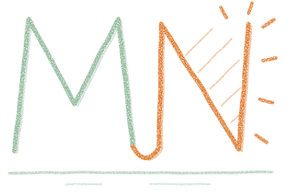

  <!-- Add your own wide banner image (e.g., 1500x400) inside an assets/ folder -->
  

  
  
  
  

  

<table>
  <tr>
    <td>
      <h2>About me</h2>
      
<b>Mayur Naik</b>, 18, Bengaluru, India.

      
Exploring <b>Cloud Computing</b> and <b>Big Data</b>—building scalable pipelines, tinkering with distributed systems, and automating workflows.

      
Big fan of <b>Linux</b> and <b>Open Source</b>. Always learning, breaking things in the terminal, and fixing them again.

    </td>
    <td width="140" align="center">
      
    </td>
  </tr>
</table>

  

<h2 align="center">Tech Stack</h2>

| Languages | Cloud & Big Data | Linux & DevOps |
|:---:|:---:|:---:|
|      |      |      |

  

<h2 align="center">Featured Projects</h2>

<table>
  <tr>
    <td width="50%">
      <a href="https://github.com/YOUR_USERNAME/REPO_1"><b>Project One</b></a> 
      Short description of your cloud or data pipeline project.  
      
      
    </td>
    <td width="50%">
      <a href="https://github.com/YOUR_USERNAME/REPO_2"><b>Project Two</b></a> 
      Short description of your Linux script, tool, or open-source work.  
      
      <img src="
